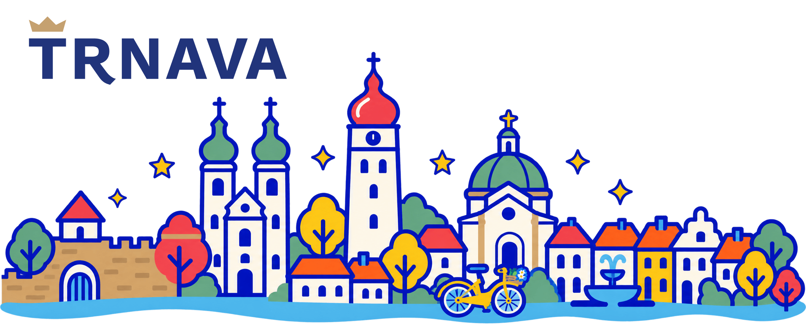

<picture>
  <source media="(prefers-color-scheme: dark)" srcset="https://raw.githubusercontent.com/trnava-city/.github/main/profile/banner-dark.png">
  <source media="(prefers-color-scheme: light)" srcset="https://raw.githubusercontent.com/trnava-city/.github/main/profile/banner.png">
  
</picture>

Welcome to an **unofficial GitHub profile for Trnava, Slovakia**. This is a place for digital projects and ideas related to Trnava, and for sharing the code, tools and knowledge behind them. Our aim is to explore ways to make everyday interactions with the city simpler, from finding information to using public services.

We believe public technology should be understandable, maintainable and useful beyond a single project. By sharing our work where possible, we want to make the development of these projects more transparent and help others build on what we learn. We also want to learn from other cities and the wider open-source community.

We share the idea behind [Public Money? Public Code!](https://publiccode.eu/): software created for the public sector with public funding should be released under a free and open-source licence, allowing everyone to use, study, share and improve it.

Cities often face similar challenges. We welcome ideas, feedback and contributions from developers, residents and other municipalities. Our goal is to turn that shared experience into practical improvements for the people who use city services every day.

[Visit the city's website](https://www.trnava.sk/)
